# Yocto-ZCU104

This project will *thoroughly* document from **start to finish** creating a simple project in Vivado to making a simple INITRAMFS image in AMD's new [Embedded Development Framework (Yocto flow)](https://xilinx-wiki.atlassian.net/wiki/spaces/A/pages/3250585601/AMD+Embedded+Development+Framework+EDF). The purpose of this is to be a reference model for Yocto-based projects moving forward as I've been so used to the old PetaLinux flow.

**Warning: 2026.2 is stated to be the final release for PetaLinux**

## Overview

- Project Version: 2026.2
- OS Version: Alma Linux 9.9
- Yocto Upstream Version: Wrynose LTS (v6.0)
- FPGA: [AMD Zynq Ultrascale+ MPSoC ZCU104](https://www.amd.com/en/products/adaptive-socs-and-fpgas/evaluation-boards/zcu104.html)

## What's New?

AMD has made some changes to their [licensing model](https://www.amd.com/en/products/software/adaptive-socs-and-fpgas/vivado/vivado-buy.html#tiers).

**At least for the free tier, you now have to register a license annually to use the free version of Vivado. Otherwise, Vivado and Vitis will not open!** I will try to document how I was able to get a license for this release. For those of you who use enterprise licenses, it doesn't seem like much has changed, but I could be wrong.

## Installation

- Dependency Installs
    - `$ gsettings set org.gnome.desktop.wm.preferences button-layout ":minimize,maximize,close"`
    - `$ sudo dnf update`
    - `$ sudo dnf install epel-release dnf-plugins-core`
    - `$ sudo dnf config-manager --set-enabled crb`
    - `$ sudo dnf makecache`
    - `$ sudo dnf install autoconf automake bzip2 ccache chrpath cpio cpp diffstat diffutils gawk gcc gcc-c++ git glib2-devel glibc-devel glibc-langpack-en glibc-locale-source gzip latexmk libacl librsvg2-tools libtool lz4 make ncurses ncurses-devel openssl openssl-devel patch perl perl-Data-Dumper perl-Text-ParseWords perl-Thread-Queue python3 python3-GitPython python3-jinja2 python3-pexpect python3-pip repo rpcgen socat tar texinfo texlive-collection-fontsrecommended texlive-collection-latex texlive-collection-latexrecommended texlive-collection-xetex texlive-fncychap texlive-gnu-freefont texlive-tex-gyre texlive-xetex uboot-tools unzip wget which xterm xz zlib zlib-devel zstd`
    - `$ sudo pip3 install sphinx sphinx_rtd_theme pyyaml`
    - `$ localectl`
        - Locale should be set to "LANG=en_US.UTF-8"
        - In case if it's not: `$ sudo localectl set-locale LANGE=en_US.UTF-8`

- Vivado Install
    - Go to [Vivado Downloads](https://www.amd.com/en/support/downloads/adaptive-socs-and-fpgas/development-tools/2026-2.html)
        - 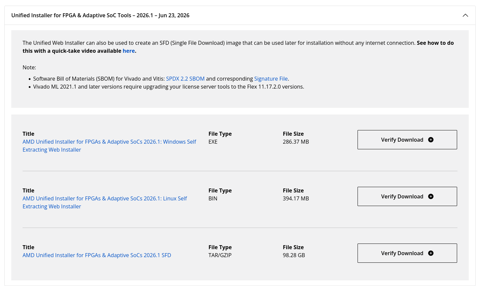
    - `$ sudo mkdir -p /opt/AMD`
    - `$ sudo chown -R $USER:$USER /opt/AMD`
    - `$ chmod +x ~/Downloads/FPGAs_AdaptiveSoCs_Unified_SDI_2026.2_1109_1430_Lin64.bin`
    - Install Vivado with the Self Extracting Installer
        - **Warning: AMD Account Required!!!**
        - `$ ~/Downloads/FPGAs_AdaptiveSoCs_Unified_SDI_2026.2_1109_1430_Lin64.bin`
    - Vivado is installed under: */opt/AMD/2026.2/Vivado*

- Yocto Artifacts (Downloads + Sstate Cache)
    - Go to [Embedded Software](https://www.amd.com/en/support/downloads/adaptive-socs-and-fpgas/embedded-software.html)
        - 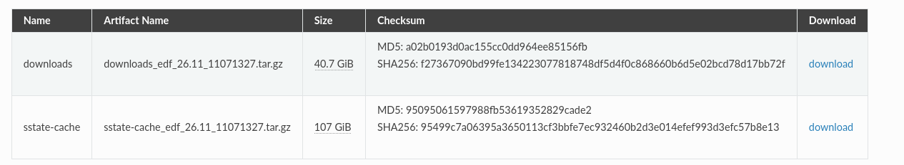
        - **Warning: AMD Account Required!!!**
    - `$ mkdir -p /opt/AMD/2026.2/Yocto/sstate-cache`
    - `$ tar -xpvf ~/Downloads/downloads_2026.2_11071215.tar.gz -C /opt/AMD/2026.2/Yocto`
    - `$ tar -xpvf ~/Downloads/sstate_aarch64_2026.2_11071215.tar.gz -C /opt/AMD/2026.2/Yocto/sstate-cache`
    
- License Acquisition
    - Go to [AMD's Vivado License Page](https://account.amd.com/en/forms/license/license-form.html)
        - **Warning: AMD Account Required!!!**
    - After signing in, you should see this menu:
        - 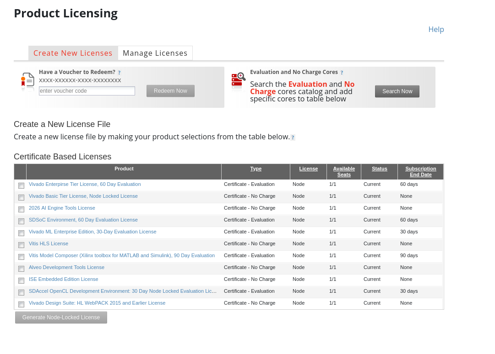
    - Under "Certificate Based Licenses", select "Vivado Basic Tier License, Node Locked License"
        - 
    - Click "Generate Node-Locked License"
    - Fill out the License Form and you should get an email associated with your AMD Account with your .lic file.
    - Download the .lic file that was emailed to you and save it.
    - Source Vivado and run Vivado License Manager
        - `$ source /opt/AMD/2026.2/Vivado/settings64.sh`
        - `$ vlm`
    - After opening the License Manager, go to the Load License tab, and click "Copy License..."
        - 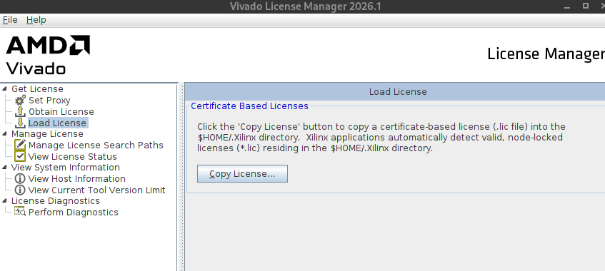
    - Select the .lic file you just saved and your license should now be applied
        - **Warning: Free licenses seem to only last for a year, so you must renew your license anually to keep using the free version of Vivado**

- Tar Upgrade
    - Read [this archived e-mail](https://www.mail-archive.com/openembedded-core@lists.openembedded.org/msg214999.html) for context of why we need to do this.
    - **Warning: As of November 17th, 2026, RHEL has not updated their mirrors to host v1.35 of the `tar` package yet. Thus, we will need to manually build v1.35 from source**
    - Grab tar v1.35 from one of the [GNU mirrors](https://ftp.wayne.edu/gnu/tar/). GNU has quite a bit of mirrors so if a tarball is not downloading or fetching quick enough, just pick another one.
        - `$ cd ~/Downloads`
        - `$ wget https://ftp.gnu.org/gnu/tar/tar-1.35.tar.xz`
        - `$ tar -xvf ./tar-1.35.tar.xz`
        - `$ cd ./tar-1.35`
        - `$ ./configure`
        - `$ make`
        - `$ sudo dnf remove tar`
        - `$ sudo make install`
    - Once v1.35+ is hosted on official RHEL servers, uninstall the source-built tar and install the package-managed tar:
        - `$ cd ~/Downloads/tar-1.35`
        - `$ sudo make uninstall`
        - `$ sudo rm -v /usr/bin/tar`
        - `$ sudo dnf install tar`

- Install AMD's buildtools for `gen-machine-conf`
    - `$ cd ~/Downloads`
    - `$ wget https://edf.amd.com/sswreleases/rel-v2026.2/sdkupdate/buildtools`
    - `$ ./buildtools -d /opt/AMD/2026.2/Yocto`

- Optional: Visual Studio Code
    - `$ sudo rpm --import https://packages.microsoft.com/keys/microsoft.asc`
    - `$ echo -e "[code]\nname=Visual Studio Code\nbaseurl=https://packages.microsoft.com/yumrepos/vscode\nenabled=1\nautorefresh=1\ntype=rpm-md\ngpgcheck=1\ngpgkey=https://packages.microsoft.com/keys/microsoft.asc" | sudo tee /etc/yum.repos.d/vscode.repo > /dev/null`
    - `$ dnf check-update`
    - `$ sudo dnf install code`
    - Extensions
        - C/C++
        - Makefile Tools
        - Python
        - Bash IDE
        - Embedded Linux Kernel Dev
        - Yocto Project BitBake
        - Verilog-HDL

## Vivado

After installing everything I need, open Vivado.

- `$ cd ~/workspace/Yocto-ZCU104/Vivado`
- `$ source /opt/AMD/2026.2/Vivado/settings64.sh`
- `$ vivado ./simple-zcu104.xpr`

I'm going to start with the PL design using Vivado. The PL design will be pretty simple. It will only use the LEDs, push buttons, and DIP switches included into the ZCU104 via AXI GPIO.

*I'm able to enable Dark Mode with these by simply enabling "New Vivado IDE" at the settings menu:*

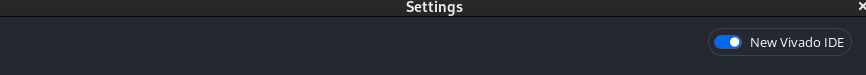

Block Design:

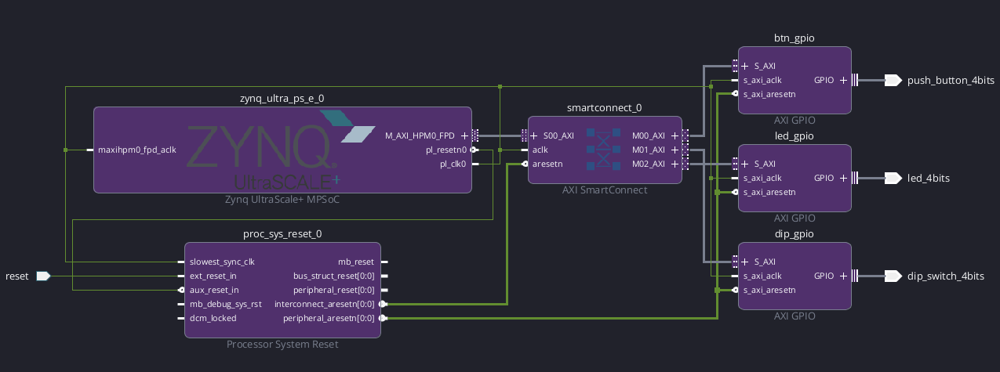

For some reason, Vivado tries to request screen sharing when I compile. To stop this, I had to disable the alerts (Settings --> Tool Settings --> Window Behavior --> Alerts):

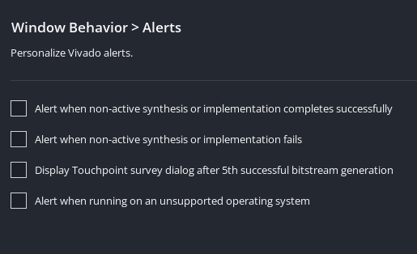

After generating the bitstream, I exported the hardware platform.

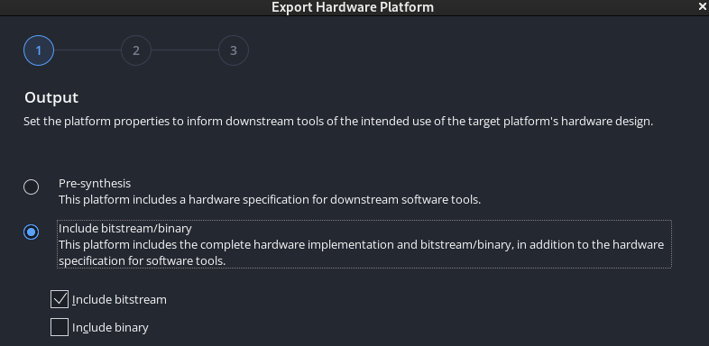

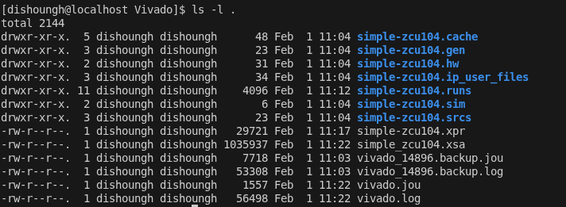

After generating the XSA, I created the System Device Tree (SDT) using `SDTGen`.

- `$ sdtgen`
- `sdtgen% set_dt_param -dir ../SDT -xsa ./simple_zcu104.xsa`
- `sdtgen% generate_sdt`
- `sdtgen% exit`

This is what the generated SDT looks like:

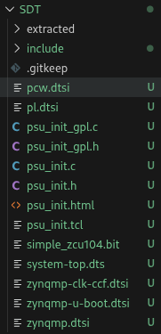

**TODO: I would like for there to be a script to automate the SDT generation process**

## Yocto

I have generated an XSA and derived the SDT ([System Device Tree](https://static.linaro.org/connect/lvc20/presentations/LVC20-314-0.pdf)) from it. Now it's time to create the Yocto project. **The goal is to create an INITRAMFS-based image that will start a `systemd` service. This service will autostart a `TCP server`.**

### Getting Yocto Manifests Repo

To start with AMD's EDF, I need to use `repo` (this was installed in the [Installation section](#installation)) to grab the necessary components to build our image for ZCU104.

- `$ cd ~/workspace/Yocto-ZCU104/Yocto`
- `$ repo init -u https://github.com/Xilinx/yocto-manifests.git -b rel-v2026.2 -m default-edf.xml`
- `$ repo sync`

With the `repo sync` command, we now should have everything for EDF. However, I'm going to remove repo's metadata and all of the layer's git metadata so our larger git project will add and push to my repo. **Yes, I know I'm not supposed to do this, but I don't care for this demo until I know of a better way to version control this project.**

- `$ rm -rfv ./.repo/`
- `$ rm -v ./sources/*/.git`
- `$ rm -rfv ./sources/*/.github`
- `$ rm -v ./sources/meta-xilinx/meta-xilinx-core/gen-machine-conf/.git`

### Sourcing Yocto Development

Now we've got all the layers we need to start, let's source the Yocto environment.

- `$ source ./edf-init-build-env`

After doing this, you should now be put into a build folder. **Note: From now on, for all subsequent commands, this guide will assume you are located in the build folder.**

Let's create our own layer to put our own modifications and applications:
- `bitbake-layers create-layer ../sources/meta-custom`
- `bitbake-layers add-layer ../sources/meta-custom`

Now I want to do some extra things. I want to create a "reference" *bblayers.conf* and *local.conf*:
- bblayers.conf: BitBake uses this to find the paths of all the available layers
- local.conf: Our top level Yocto configuration file

The reason I want to do this is because, traditionally, you're not supposed to version control your build. But unfortunately, I don't know how to structure Yocto projects correctly for our version control cases yet. So, I'll just do the cheap thing which is extend the `edf-init-build-env` script to copy the reference files to the build.

1. `$ chmod 755 ../edf-init-build-env`
2. `$ cp ./conf/bblayers.conf ../reference-bblayers.conf`
3. `$ cp ./conf/local.conf ../reference-local.conf`
4. Edit reference bblayers conf

```
# POKY_BBLAYERS_CONF_VERSION is increased each time build/conf/bblayers.conf
# changes incompatibly
POKY_BBLAYERS_CONF_VERSION = "2"

BBPATH = "${TOPDIR}"
BBFILES ?= ""

YOCTOROOT = "${@os.path.abspath(os.path.join("${TOPDIR}", os.pardir))}"

BBLAYERS ?= " \
  ${YOCTOROOT}/sources/poky/meta \
  ${YOCTOROOT}/sources/poky/meta-poky \
  ${YOCTOROOT}/sources/poky/../meta-openembedded/meta-oe \
  ${YOCTOROOT}/sources/poky/../meta-openembedded/meta-python \
  ${YOCTOROOT}/sources/poky/../meta-openembedded/meta-filesystems \
  ${YOCTOROOT}/sources/poky/../meta-openembedded/meta-networking \
  ${YOCTOROOT}/sources/poky/../meta-openembedded/meta-multimedia \
  ${YOCTOROOT}/sources/poky/../meta-openembedded/meta-webserver \
  ${YOCTOROOT}/sources/poky/../meta-virtualization \
  ${YOCTOROOT}/sources/poky/../meta-security \
  ${YOCTOROOT}/sources/poky/../meta-security/meta-tpm \
  ${YOCTOROOT}/sources/poky/../meta-xilinx/meta-xilinx-core \
  ${YOCTOROOT}/sources/poky/../meta-xilinx/meta-xilinx-standalone \
  ${YOCTOROOT}/sources/poky/../meta-xilinx/meta-xilinx-standalone-sdt \
  ${YOCTOROOT}/sources/poky/../meta-xilinx/meta-xilinx-multimedia \
  ${YOCTOROOT}/sources/poky/../meta-xilinx/meta-xilinx-demos \
  ${YOCTOROOT}/sources/poky/../meta-xilinx/meta-xilinx-virtualization \
  ${YOCTOROOT}/sources/poky/../meta-xilinx/meta-xilinx-mali400 \
  ${YOCTOROOT}/sources/poky/../meta-xilinx/meta-xilinx-gpu-malig78ae \
  ${YOCTOROOT}/sources/poky/../meta-xilinx/meta-microblaze \
  ${YOCTOROOT}/sources/poky/../meta-xilinx/meta-amd-zephyr \
  ${YOCTOROOT}/sources/poky/../meta-xilinx-tsn \
  ${YOCTOROOT}/sources/poky/../meta-openamp \
  ${YOCTOROOT}/sources/poky/../meta-amd-edf \
  ${YOCTOROOT}/sources/poky/../meta-amd-edf/meta-amd-edf-bsp \
  ${YOCTOROOT}/sources/poky/../meta-kria \
  ${YOCTOROOT}/sources/poky/../meta-amd-adaptive-socs/meta-amd-adaptive-socs-core \
  ${YOCTOROOT}/sources/poky/../meta-amd-adaptive-socs/meta-amd-adaptive-socs-bsp \
  ${YOCTOROOT}/sources/poky/../meta-xilinx/meta-xilinx-imgrcvry \
  ${YOCTOROOT}/sources/poky/../meta-arm/meta-arm \
  ${YOCTOROOT}/sources/poky/../meta-arm/meta-arm-toolchain \
  ${YOCTOROOT}/sources/poky/../meta-jupyter \
  ${YOCTOROOT}/sources/poky/../meta-ros/meta-ros-common \
  ${YOCTOROOT}/sources/poky/../meta-ros/meta-ros2 \
  ${YOCTOROOT}/sources/poky/../meta-ros/meta-ros2-jazzy \
  ${YOCTOROOT}/sources/poky/../meta-qt5 \
  ${YOCTOROOT}/sources/poky/../meta-vitis \
  ${YOCTOROOT}/sources/poky/../meta-zephyr/meta-zephyr-core \
  ${YOCTOROOT}/sources/poky/../meta-zephyr/meta-zephyr-bsp \
  ${YOCTOROOT}/sources/poky/../meta-embedded-plus \
  ${YOCTOROOT}/sources/meta-custom \
  "
```

5. Edit reference local conf

```
# Source and Sstate mirror settings
AMD-EDF_VERSION ??= "26.11"

PREMIRRORS:prepend = "\
http://.*/.* file:///opt/AMD/2026.2/Yocto/downloads \
https://.*/.* file:///opt/AMD/2026.2/Yocto/downloads \
http://.*/.* http://downloads.yoctoproject.org/mirror/sources/ \
https://.*/.* https://downloads.yoctoproject.org/mirror/sources/"

SSTATE_MIRRORS = "file://.* file:///opt/AMD/2026.2/Yocto/sstate-cache/PATH"
```

6. Edit edf-init-build-env

```
rm -v $ROOT/build/conf/{bblayers.conf,local.conf}
ln -sv $ROOT/reference-bblayers.conf $ROOT/build/conf/bblayers.conf
ln -sv $ROOT/reference-local.conf $ROOT/build/conf/local.conf
source /opt/AMD/2026.2/Yocto/environment-setup-x86_64-petalinux-linux
```

7. `$ cd ../ && source ./edf-init-build-env`
    - Now from now on, the bblayers.conf and local.conf should point to the reference confs that will be pushed to the remote repo.

### Import System Device Tree

After creating my custom layer (meta-custom), I edit the layer.conf to add dependencies and import the SDT:

- `$ rm -rfv ../sources/meta-custom/recipes-example/`
- `$ vim ../sources/meta-custom/conf/layer.conf`

 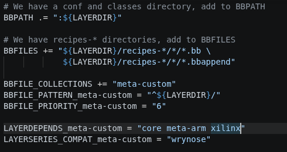

- `$ gen-machine-conf parse-sdt --hw-description ../../SDT --machine-name zcu104 --config-dir ../sources/meta-custom/conf/`
    - Set MACHINE = "zcu104" in local.conf

### Device Tree Configuration

Now that we've imported our device tree, now we have to add modifications to our DTS such as attaching the `genirq` UIO drivers to our IP blocks. This will allow us to access our PL IPs from userspace as `/dev/uio(X)`.

- `$ mkdir -p ../sources/meta-custom/recipes-bsp/device-tree/files`
- `$ vim ../sources/meta-custom/recipes-bsp/device-tree/files/dts-mods.dtsi`

```
/ {
    // AMD Zynq Ultrascale+ MPSoC ZCU104
    model = "Zynq MPSoC ZCU104 Development Board";
    compatible = "xlnx,zynqmp-zcu104-revC", "xlnx,zynqmp-zcu104", "xlnx,zynqmp";

    // Boot Arguments
    chosen {
        bootargs = "console=ttyPS0,115200 earlycon earlyprintk clk_ignore_unused irqpoll cpuidle.off=1 uio_pdrv_genirq.of_id=generic-uio";
        stdout-path = "serial0:115200n8";
    };
};

// Processing System
&gem3 {
    status = "okay";
    local-mac-address = [00 0a 35 00 1e 53];
	phy-handle = <&phy0>;
	pinctrl-names = "default";
	pinctrl-0 = <&pinctrl_gem3_default>;
	mdio: mdio {
		#address-cells = <1>;
		#size-cells = <0>;
		phy0: ethernet-phy@c {
			#phy-cells = <1>;
			compatible = "ethernet-phy-id2000.a231";
			reg = <0xc>;
			ti,rx-internal-delay = <0x8>;
			ti,tx-internal-delay = <0xa>;
			ti,fifo-depth = <0x1>;
			ti,dp83867-rxctrl-strap-quirk;
		};
	};
};

&pinctrl0 {
	status = "okay";

	pinctrl_gem3_default: gem3-default {
		mux {
			function = "ethernet3";
			groups = "ethernet3_0_grp";
		};

		conf {
			groups = "ethernet3_0_grp";
			slew-rate = <1>;
			power-source = <1>;
			drive-strength = <12>;
		};

		conf-rx {
			pins = "MIO70", "MIO71", "MIO72", "MIO73", "MIO74",
									"MIO75";
			bias-high-impedance;
			low-power-disable;
		};

		conf-tx {
			pins = "MIO64", "MIO65", "MIO66", "MIO67", "MIO68",
									"MIO69";
			bias-disable;
			low-power-enable;
		};

		mux-mdio {
			function = "mdio3";
			groups = "mdio3_0_grp";
		};

		conf-mdio {
			groups = "mdio3_0_grp";
			slew-rate = <1>;
			power-source = <1>;
			bias-disable;
		};
	};

	pinctrl_sdhci1_default: sdhci1-default {
		mux {
			groups = "sdio1_0_grp";
			function = "sdio1";
		};

		conf {
			groups = "sdio1_0_grp";
			slew-rate = <1>;
			power-source = <1>;
			bias-disable;
			drive-strength = <12>;
		};

		mux-cd {
			groups = "sdio1_cd_0_grp";
			function = "sdio1_cd";
		};

		conf-cd {
			groups = "sdio1_cd_0_grp";
			bias-high-impedance;
			bias-pull-up;
			slew-rate = <1>;
			power-source = <1>;
		};
	};

	
};

/* SD1 with level shifter */
&sdhci1 {
    status = "okay";
	no-1-8-v;
	pinctrl-names = "default";
	pinctrl-0 = <&pinctrl_sdhci1_default>;
};


// Programmable Logic
&amba_pl {
    //uio0
    btn_gpio: gpio@a0000000 {
        compatible = "generic-uio";
        reg = <0x0 0xa0000000 0x0 0x10000>;
    };

    //uio1
    dip_gpio: gpio@a0010000 {
        compatible = "generic-uio";
        reg = <0x0 0xa0010000 0x0 0x10000>;
    };

    //uio2
    led_gpio: gpio@a0020000 {
        compatible = "generic-uio";
        reg = <0x0 0xa0020000 0x0 0x10000>;
    };
};
```

- `$ vim ../sources/meta-custom/recipes-bsp/device-tree/device-tree.bbappend`
```
FILESEXTRAPATHS:prepend := "${THISDIR}/files:"

SRC_URI:append = " file://dts-mods.dtsi"
EXTRA_DT_INCLUDE_FILES:append:linux = " dts-mods.dtsi"
EXTRA_DT_INCLUDE_FILES:append:linux-gnueabi = " dts-mods.dtsi"
```

### Kernel Configuration

We now have our device tree accounted for! Now let's configure the kernel to build the UIO platform drivers into.

- `$ mkdir -p ../sources/meta-custom/recipes-kernel/linux-xlnx/files`
- `$ touch ../sources/meta-custom/recipes-kernel/linux-xlnx/files/kernel.cfg`
- `$ bitbake virtual/kernel -c menuconfig`
    - CONFIG_PREEMPT_RT=y
    - CONFIG_PREEMPT_RT_NEEDS_BH_LOCK=y
    - CONFIG_UIO_PDRV_GENIRQ=y
    - CONFIG_UIO_DMEM_GENIRQ=y
    - CONFIG_UIO_XILINX_AI_ENGINE=y
- `$ bitbake virtual/kernel -c diffconfig`
    - This command will generate a diffconfig.
    - Merge the diffconfig into *../sources/meta-custom/recipes-kernel/linux-xlnx/files/kernel.cfg*
- `$ vim ../sources/meta-custom/recipes-kernel/linux-xlnx/linux-xlnx_%.bbappend`

```
FILESEXTRAPATHS:prepend := "${THISDIR}/files:"

SRC_URI += "file://kernel.cfg"
```

- `$ bitbake virtual/kernel -c cleansstate`

### U-Boot Configuration

I will do the same thing for U-Boot, but I will not only configure U-Boot, but I will also create my own U-Boot script.


- `$ mkdir -p ../sources/meta-custom/recipes-bsp/u-boot/files`
- `$ touch ../sources/meta-custom/recipes-bsp/u-boot/u-boot-xlnx-scr.bbappend`
- `$ touch ../sources/meta-custom/recipes-bsp/u-boot/u-boot-xlnx_%.bbappend`
- `$ touch ../sources/meta-custom/recipes-bsp/u-boot/files/custom.boot.cmd`
- `$ touch ../sources/meta-custom/recipes-bsp/u-boot/files/u-boot.cfg`
- `$ bitbake virtual/bootloader -c menuconfig`
    - CONFIG_SYS_BOOTM_LEN=0x12c00000
    - CONFIG_BOOT_SCRIPT_OFFSET=0x03280000
    - CONFIG_HAVE_SYS_MONITOR_BASE=y
    - CONFIG_SYS_MONITOR_BASE=0x8000000
    - CONFIG_QSPI_BOOT=y
    - CONFIG_SD_BOOT=y
    - CONFIG_SD_BOOT_QSPI=y
    - CONFIG_BOOTDELAY=0
    - \# CONFIG_CMD_IMLS is not set
    - CONFIG_CMD_FLASH=y
    - CONFIG_ENV_IS_DEFAULT=y
    - \# CONFIG_ENV_IS_IN_FAT is not set
    - \# CONFIG_ENV_IS_IN_NAND is not set
    - \# CONFIG_ENV_IS_IN_SPI_FLASH is not set
    - \# CONFIG_NET_RANDOM_ETHADDR is not set

- `$ bitbake virtual/bootloader -c diffconfig`
    - After this command, you will be given a path for a .cfg file. Merge the differences from that .cfg and place them into: *../sources/meta-custom/recipes-bsp/u-boot/files/u-boot.cfg*
- `$ bitbake virtual/bootloader -c cleansstate`

Last thing to edit, we'll edit the boot script that will eventually become the `boot.scr` file. This file assists the U-Boot bootloader to find the FIT image and load it into memory by the specified addresses.

- `$ vim ../sources/meta-custom/recipes-bsp/u-boot/files/custom.boot.cmd`

```
# This is a boot script for U-Boot (only supported modes are SD and QSPI).
# Generate boot.scr:
# mkimage -c none -A arm -T script -d custom.boot.cmd boot.scr

fit_name=image.itb
load_addr=0x10000000
fit_offset=0x03300000
fit_size=0x12C00000

for boot_target in ${boot_targets};
do
    echo "Trying to load boot images from ${boot_target}"
    if test "${boot_target}" = "mmc0" || test "${boot_target}" = "mmc1"; then
        if test -e ${devtype} ${devnum}:${distro_bootpart} /${fit_name}; then
            fatload ${devtype} ${devnum}:${distro_bootpart} ${load_addr} ${fit_name};
            bootm ${load_addr};
            echo "SD booting using FIT image failed"
        else
            echo "Failed to find FIT image for SD boot"
        fi
    fi
    
    if test "${boot_target}" = "xspi0" || test "${boot_target}" = "xspi1" || test "${boot_target}" = "qspi" || test "${boot_target}" = "qspi0"; then
        sf probe 0 0 0;
        sf read ${load_addr} ${fit_offset} ${fit_size}
        bootm ${load_addr};
        echo "Booting using Fit image failed"
    fi
done
```

- `$ vim ../sources/meta-custom/recipes-bsp/u-boot/u-boot-xlnx-scr.bbappend`

```
FILESEXTRAPATHS:prepend := "${THISDIR}/files:"

# Custom Bootscript
SRC_URI += "file://custom.boot.cmd"

do_compile:append() {
    mkimage -A arm -T script -C none -n "Custom U-Boot Script" -d "${UNPACKDIR}/custom.boot.cmd" boot.scr
}
```

This will call `mkimage` to overwrite the default boot.scr.

- `$ vim ../sources/meta-custom/recipes-bsp/u-boot/u-boot-xlnx_%.bbappend`

```
FILESEXTRAPATHS:prepend := "${THISDIR}/files:"

# Custom U-Boot Diffconfig
SRC_URI += "file://u-boot.cfg"
```

### RootFS Configuration

Now for one of the biggest parts of the process, configuring the rootfs. This will be split into 3 parts:

1. Custom Banner
2. Udev
3. Networking

#### <ins>Custom Banner</ins>

AMD created a custom banner that warns users that EDF is for development wonly and not meant for deployment. Technically this is true, but I want to remove this custom banner and replace it with our own.

- `$ mkdir -p ../sources/meta-custom/recipes-core/base-files/files`
- `$ vim ../sources/meta-custom/recipes-core/base-files/files/custom-motd`

```
****************************
This is our Custom Banner!!!
****************************
```

- `$ vim ../sources/meta-custom/recipes-core/base-files/base-files_%.bbappend`

```
FILESEXTRAPATHS:prepend := "${THISDIR}/files:"

SRC_URI += "file://custom-motd"

do_install:append() {
    install ${UNPACKDIR}/custom-motd ${D}${sysconfdir}/motd
}
```

#### <ins>Udev</ins>

We will append to the udev rules. udev is the Linux kernel's device manager utility. We will modify the rules for udev so that each detected network interface will be renamed back to `end0`. This is to we can easily script out networking configurations in our initscripts.

- `$ mkdir -p ../sources/meta-custom/recipes-core/eudev/files`
- `$ vim ../sources/meta-custom/recipes-core/eudev/files/70-persistent-net.rules`

```
# Prevent Ethernet Renaming from end0
SUBSYSTEM=="net", ACTION=="add", DRIVERS=="?*", ATTR{address}=="00:0a:35:00:1e:53", ATTR{type}=="1", KERNEL=="eth*", NAME="end0"
```
**NOTE: The ATTR{address} must match the MAC address in the device tree**

- `$ vim ../sources/meta-custom/recipes-core/eudev/eudev_%.bbappend`

```
FILESEXTRAPATHS:prepend := "${THISDIR}/files:"

SRC_URI += "file://70-persistent-net.rules"

do_install:append() {
    install -d ${D}${sysconfdir}/udev/rules.d
    install -m 0644 ${UNPACKDIR}/70-persistent-net.rules ${D}${sysconfdir}/udev/rules.d/
}
```

#### <ins>Networking</ins>

Now that we told udev to preserve the ethernet interface naming schema we want, now we have to initialize `end0` with IP address, netmask, and gateway settings on bootup.

- `$ mkdir -p ../sources/meta-custom/recipes-core/init-ifupdown/files`
- `$ vim ../sources/meta-custom/recipes-core/init-ifupdown/files/interfaces`

```
# /etc/network/interfaces -- configuration file for ifup(8), ifdown(8)
# The loopback interface
auto lo
iface lo inet loopback

auto end0
iface end0 inet static
    address 192.168.1.10
    netmask 255.255.255.0
    gateway 192.168.1.1
```

- `$ vim ../sources/meta-custom/recipes-core/init-ifupdown/init-ifupdown_%.bbappend`

```
FILESEXTRAPATHS:prepend := "${THISDIR}/files:"

SRC_URI += "file://interfaces"

do_install:append() {
    install -m 0644 ${UNPACKDIR}/interfaces ${D}${sysconfdir}/network/interfaces
}
```

### TCP Server

Now it's time to add in our custom applications and scripts. First, let's create a TCP server. This TCP server will, via UIO ([Userspace I/O](https://www.kernel.org/doc/html/latest/driver-api/uio-howto.html)), write and read from the AXI GPIO controlling the ZCU104's LEDs, push buttons, and DIP switch. In general, if the TCP server will do the following actions based on the commands:
- `LED?`: Queries the current LED value
- `LED=[VAL]`: Sets the LED value to [VAL]
    - [VAL] = 0 - 15
- `BTN?`: Queries the current button value
- `DIP?`: Queries the current DIP value

If any other command is detected, you will receive an error message.

- `$ mkdir -p ../sources/meta-custom/recipes-apps/tcp-server/files`
- `$ vim ../sources/meta-custom/recipes-apps/tcp-server/files/tcp-server.c`

```
See file contents (too many lines)
```

- `$ vim ../sources/meta-custom/recipes-apps/tcp-server/files/Makefile`

```
APP = tcp-server

APP_OBJS += tcp-server.o

all: build

build: $(APP)

$(APP): $(APP_OBJS)
	$(CC) -o $@ $(APP_OBJS) $(LDFLAGS) $(LDLIBS)

clean:
	rm -f $(APP) *.o
```

- `$ vim ../sources/meta-custom/recipes-apps/tcp-server/tcp-server.bb`

```
#
# This file is the tcp-server recipe.
#

SUMMARY = "Simple tcp-server app"
SECTION = "KCNSC/apps"
LICENSE = "MIT"
LIC_FILES_CHKSUM = "file://${COMMON_LICENSE_DIR}/MIT;md5=0835ade698e0bcf8506ecda2f7b4f302"

# Source Files
SRC_URI += "file://tcp-server.c"
SRC_URI += "file://Makefile"

S = "${UNPACKDIR}"

# Dependencies

# Build-time Provision
PROVIDES = "tcp-server"

# Tasks
do_compile() {
    oe_runmake
}

do_install() {
    install -d ${D}${bindir}
    install -m 0755 tcp-server ${D}${bindir}
}
```

### SystemD Initscript

- `$ mkdir -p ../sources/meta-custom/recipes-apps/bootscript/files`
- `$ vim ../sources/meta-custom/recipes-apps/bootscript/files/bootscript.service`

```
[Unit]
Description=simple-script
Requires=network.target
After=network.target dropbear.socket
  
[Service]
Type=oneshot
Restart=no
ExecStart=/usr/bin/bootscript.sh
StandardOutput=tty
  
[Install]
WantedBy=multi-user.target
```

- `$ vim ../sources/meta-custom/recipes-apps/bootscript/files/bootscript.sh`
	- **NOTE: It will be better to set the IP address like this:**
 		- `ip addr del 192.168.1.10/24 dev end0`
   		- `ip addr add 192.168.1.(X)/24 dev end0`

```
#!/bin/bash

echo -e "######## Bootscript Start! ########"

# Try to configure ethernet
ifconfig end0 192.168.1.10 netmask 255.255.255.0

if [ $? -ne 0 ]; then
    echo "Network configuration failed!"
    exit 1
else
    echo "Network configured successfully"
fi

# Mount SD Card
mkdir -p /mnt/sd
mount /dev/mmcblk0p1 /mnt/sd
echo "Mounted SD"
tcp-server
exit 0
```

- `$ vim ../sources/meta-custom/recipes-apps/bootscript/bootscript.bb`

```
#
# This file is the bootscript recipe.
#

SUMMARY = "Simple bootscript application"
SECTION = "apps"
LICENSE = "MIT"
LIC_FILES_CHKSUM = "file://${COMMON_LICENSE_DIR}/MIT;md5=0835ade698e0bcf8506ecda2f7b4f302"

FILESEXTRAPATHS:prepend := "${THISDIR}/files:"
  
inherit systemd

SYSTEMD_SERVICE:${PN} = "bootscript.service"
SYSTEMD_AUTO_ENABLE:${PN} = "enable"

RDEPENDS:${PN} = "bash"

S = "${UNPACKDIR}"

SRC_URI += "file://bootscript.service"
SRC_URI += "file://bootscript.sh"

do_install() {
	install -d ${D}${systemd_system_unitdir}
	install -m 0644 ${S}/bootscript.service ${D}${systemd_system_unitdir}
	install -d ${D}${bindir}
	install -m 0755 ${S}/bootscript.sh ${D}/${bindir}
}
```

### Final Yocto Project Configurations

We are about almost done. Add the following at the very end of *local.conf*:

```
################################################################################
############################ User Settings #####################################
################################################################################

# Kernel Settings
INITRAMFS_IMAGE_BUNDLE = "1"
INITRAMFS_IMAGE = "core-image-minimal"
INITRAMFS_IMAGE_NAME = "${INITRAMFS_IMAGE}-${MACHINE}.rootfs"
INITRAMFS_MAXSIZE = "524288"
IMAGE_FSTYPES = "${INITRAMFS_FSTYPES}"
KERNEL_CLASSES += "kernel-fit-extra-artifacts"
PREFERRED_PROVIDER_virtual/kernel = "linux-xlnx"

# Rootfs Settings
INIT_MANAGER = "systemd"
NETWORK_MANAGER = "networkmanager"
DISTRO_FEATURES:append = " timezone"
PACKAGE_INSTALL = ""

IMAGE_FEATURES = "allow-root-login allow-empty-password empty-root-password serial-autologin-root"
EXTRA_USERS_PARAMS = "usermod -p '\$1\$NdGrWAeq\$MNcNo3i8/M5lJ.NnmjYTR.' root;"
PACKAGE_INSTALL:append = " dropbear"

PACKAGE_INSTALL:append = " base-files"
PACKAGE_INSTALL:append = " base-passwd"
PACKAGE_INSTALL:append = " bootscript"
PACKAGE_INSTALL:append = " bridge-utils"
PACKAGE_INSTALL:append = " busybox"
PACKAGE_INSTALL:append = " dbus"
PACKAGE_INSTALL:append = " device-tree"
PACKAGE_INSTALL:append = " dtc"
PACKAGE_INSTALL:append = " fpga-manager-script"
PACKAGE_INSTALL:append = " init-ifupdown"
PACKAGE_INSTALL:append = " initscripts"
PACKAGE_INSTALL:append = " iptables"
PACKAGE_INSTALL:append = " kmod"
PACKAGE_INSTALL:append = " mtd-utils"
PACKAGE_INSTALL:append = " mtd-utils-jffs2"
PACKAGE_INSTALL:append = " mtd-utils-ubifs"
PACKAGE_INSTALL:append = " netbase"
PACKAGE_INSTALL:append = " openssl"
PACKAGE_INSTALL:append = " packagegroup-core-boot"
PACKAGE_INSTALL:append = " shadow"
PACKAGE_INSTALL:append = " shadow-securetty"
PACKAGE_INSTALL:append = " systemd"
PACKAGE_INSTALL:append = " tcp-server"
PACKAGE_INSTALL:append = " tzdata"
PACKAGE_INSTALL:append = " tzdata-americas"
PACKAGE_INSTALL:append = " u-boot-tools-xlnx"
PACKAGE_INSTALL:append = " u-boot-xlnx-scr"
PACKAGE_INSTALL:append = " udev-extraconf"
PACKAGE_INSTALL:append = " uio-test"
```

For the root password, Poky only accepts encrypted passwords. This is done in the following manner:
- `$ openssl passwd -1 (PASSWD) | sed 's/\$/\\\$/g'`
	- This will generate an encrypted password with each dollar sign escaped. We need to do this or BitBake will interpret the dollar signs as trying to reference a variable. Copy this output into the '(HASH)' part in the local.conf. For example:
 	- openssl passwd -1 testpassword | sed 's/\$/\\\$/g' --> \$1\$pKP1spiZ\$4iZbQK3.b4hdNPCuMTeFD0
    	- Now put this line in the local.conf: `EXTRA_USERS_PARAMS = "usermod -p '\$1\$pKP1spiZ\$4iZbQK3.b4hdNPCuMTeFD0' root;"`
    		- **Notice how each dollar sign is escaped. Keep that in mind!** 

### Building Project

We're now done configuring everything and it's time for a build:

- `$ bitbake core-image-minimal`

**The build was successful; however, the build failed to produce a fitImage file as I've been able to do in the past. I need to figure out how to get this working on Wrynose**

### Manually Packaging Image

Unfortunately, I still haven't figured out how to have Yocto automatically generate the FIT image, but I think I have a way to **manually** compile and deploy a FIT image. This is how I did it:

1. `vim ./image.its`
    - **Warning: Make sure the compatible property for the system configuration matches what you put for your device tree**
```
/dts-v1/;

/ {
	description = "Custom FIT Image Source File for EDF Demo";
	#address-cells = <1>;
	
	images {
		sys-kernel {
			description = "Linux kernel";
			data = /incbin/("linux.bin");
			type = "kernel";
			arch = "arm64";
			os = "linux";
			compression = "gzip";
			load = <0x00200000>;
			entry = <0x00200000>;
			
			hash-1 {
				algo = "sha256";
			};
		};
		
		sys-fdt {
			description = "Flattened Device Tree Blob";
			data = /incbin/("system.dtb");
			type = "flat_dt";
			arch = "arm64";
			compression = "none";
			
			hash-1 {
				algo = "sha256";
			};
		};
	};
	
	configurations {
		default = "sys-conf";
		sys-conf {
			description = "System Configuration";
			compatible = "xlnx,zynqmp-zcu104-revC", "xlnx,zynqmp-zcu104", "xlnx,zynqmp";
			kernel = "sys-kernel";
			fdt = "sys-fdt";
			
			hash-1 {
				algo = "sha256";
			};
		};
	};
};
```

2. `mkdir -p ../extracted-images`
3. `cp -Lv ./tmp/deploy/images/zcu104/BOOT-zcu104.bin ./BOOT.BIN`
4. `cp -v ./tmp/deploy/images/zcu104/boot.scr ./boot.scr`
5. `cp -v ./tmp/deploy/images/zcu104/linux.bin ./linux.bin`
6. `cp -Lv ./tmp/deploy/images/zcu104/system.dtb ./system.dtb`
7. `cp -v ./tmp/deploy/images/zcu104/fsbl-zcu104.elf ./zynqmp_fsbl.elf`
8. `mkimage -f ./image.its ./image.itb`
9. `rm -v ./linux.bin`
10. `mv -v ./{BOOT.BIN,boot.scr,image.its,image.itb,system.dtb,zynqmp_fsbl.elf} ../extracted-images/`

**Note: I have not tested this yet, but I will give an update when I have a chance!**
